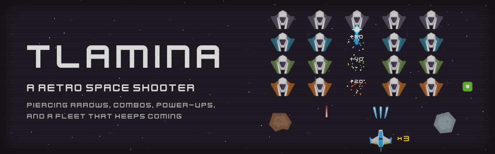

# 🛸 Tlamina



[](https://github.com/landoicco/tlamina/actions/workflows/ci.yml)
[](https://github.com/landoicco/tlamina/releases/latest)
[](LICENSE)


A retro space shooter built with [pygame-ce](https://pyga.me/). Hold off an alien fleet that comes back faster every wave: take cover behind the meteors, charge arrows that pierce whole columns, chain hits into a score multiplier, and grab the power-ups the bonus UFO drops. 👾

> 🏹 **Tlamina** is a Nahuatl verb meaning *to shoot arrows* ([Gran Diccionario Náhuatl](https://gdn.iib.unam.mx/diccionario/tlamina)). In this game, your strongest weapon is a charged arrow that flies through every enemy in its path.

## 🎮 How to play

| Key | Action |
|---|---|
| <kbd>←</kbd> <kbd>→</kbd> | Move |
| <kbd>Space</kbd> | Shoot a laser 🔫 |
| Hold <kbd>Space</kbd>, then release | Fire a charged arrow that pierces every enemy in its path 🏹 |
| <kbd>Esc</kbd> | Pause and resume |
| <kbd>Enter</kbd> | Play again after a game over |

Every 5 hits in a row raise the combo multiplier, up to ×4, so line the arrow up under a column. Shooting down the bonus UFO drops a power-up: ⭐ Volley, ⚡ Rapid fire, or 🛡️ Shield. You have three lives, and your best score is saved between runs. The full rules are in the [game design document](docs/game-design.md).

## 📥 Download

Get the latest build from the [releases page](https://github.com/landoicco/tlamina/releases/latest). Each package is a single executable, no installation needed.

- 🪟 **Windows**: unzip `tlamina-windows.zip` and run `Tlamina.exe`. The executable isn't signed, so SmartScreen may warn about it the first time: choose *More info* → *Run anyway*.
- 🐧 **Linux**: extract `tlamina-linux.tar.gz` and run `./Tlamina`. Needs glibc 2.35 or newer (Ubuntu 22.04 and later).

## 🚀 Running from source

Requires Python 3.11 or newer. With [uv](https://docs.astral.sh/uv/):

```sh
uv run python -m tlamina
```

Or with Nix: `nix develop`, then `python -m tlamina`.

## 🧪 Development

Lint and tests run in CI on every push and pull request. To run them locally (inside `nix develop`, or prefixed with `uv run`):

```sh
ruff check .
pytest
```

To build an executable for your platform, run `uv run --group build python tools/build_exe.py`; the result goes to `dist/`.

- 🏗️ [Architecture](docs/architecture.md): how the code is organized and the *Game Programming Patterns* it uses
- 🎯 [Game design](docs/game-design.md): what the game is trying to be, and what it leaves out
- 🛠️ [Tools](tools/README.md): rebuilding the sprite atlas

## 🌱 From tutorial to finished game

Tlamina started in December 2021 as my take on [Clear Code](https://www.youtube.com/@ClearCode)'s [pygame Space Invaders tutorial](https://github.com/clear-code-projects/Space-invaders), and the first commits follow the video step by step. In 2026 I came back to it to turn it into a complete, polished game, and to practice what a small project looks like when it's built properly.

| | Tutorial starting point | Tlamina today |
|---|---|---|
| **Gameplay** | One fleet, one kind of shot | Endless waves, armored enemies, charged arrow, combo multiplier, power-ups |
| **Screens** | The window closes on game over | Splash, pause, and game over screens, and a saved high score |
| **Art and audio** | The tutorial's own files | Kenney's CC0 packs, packed into a sprite atlas by a script; CRT effect drawn in code |
| **Feel** | Sprites disappear on hit | Explosions, floating points, damage cracks, screen shake |
| **Code** | A few modules with global state, frame-based movement | A `tlamina` package organized by role, delta-time movement, design patterns documented in [`docs/`](docs/architecture.md) |
| **Quality** | No tests | 105 tests, strict linting, CI on every pull request |
| **Distribution** | Run from source | Linux and Windows executables built and released automatically |

### 🤖 Built with AI assistance

The 2026 work was done with [Claude Code](https://claude.com/claude-code) as a pair programmer. I set the direction and made the design decisions, from the [game design document](docs/game-design.md) to how the code is organized, reviewed every change, and made every commit. Claude Code helped write the code, the tests, and the documentation, and reviewed the project for bugs along the way.

## 📄 Credits and license

The code is released under the [MIT License](LICENSE). The art and audio are **not my own work** and aren't covered by it: sprites and sound effects are by [Kenney](https://www.kenney.nl) and the music is by [yd](https://opengameart.org/users/yd), all under CC0. See [`CREDITS.md`](CREDITS.md) for per-asset attribution, and [`THIRD_PARTY_NOTICES.md`](THIRD_PARTY_NOTICES.md) for the libraries bundled in the executables.
