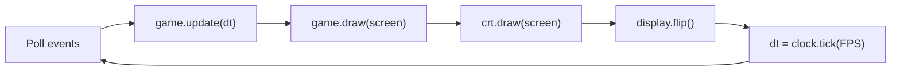

# 🏗️ Architecture

## Modules

All the code lives in the `tlamina` package, grouped by the role each module plays rather than by feature: in a game, every feature meets every other one in the same loop and the same collision checks, so slicing by feature would split code that changes together.

| Module | Role |
|---|---|
| `__main__.py` | Creates the window and runs the [game loop](patterns/game-loop.md); `python -m tlamina` starts here |
| `scenes.py` | Splash, playing, pause, and game over screens, each deciding which one comes next |
| `game.py` | Owns the game state: sprite groups, score, lives, waves, timers, collisions, and fleet movement |
| `highscore.py` | Loads and saves the high score in the user's data folder |
| `resources.py` | Resolves asset paths, cuts sprites out of the atlas by name, and caches images, sounds, and fonts ([Flyweight](patterns/flyweight.md)) |
| `settings.py` | Gameplay tuning values. Speeds are in pixels per second and times in seconds |
| `entities/` | Sprites that move and collide: `player`, `enemy`, `laser`, `obstacle`. Each one moves itself in `update(dt)` ([Update Method](patterns/update-method.md)) |
| `visuals/` | Things that are only drawn and never affect the game: `background`, the `crt` overlay, and `ui` text |

Dependencies point one way: `__main__` → `scenes` → `game` → `entities` → `resources` / `settings`. Entities never import `game`, so each one can be created and tested on its own.

## One frame

`game.update(dt)` runs in a fixed order:

1. Player input, movement, and shooting cooldown
2. Timers: bonus alien spawn and UFO shots
3. Collisions: lasers against UFOs, the alien, obstacles, and the player
4. UFO fleet movement and edge bounces
5. Laser and alien movement, removing anything that left the screen

Logic and drawing are separate, so tests can call `update(dt)` with a fixed `dt` and check the state without opening a window.

## State

`Game.state` is either `playing` or `game_over`. `main.py` closes the game on `game_over` for now; phase 5 replaces this with scenes (State pattern).
