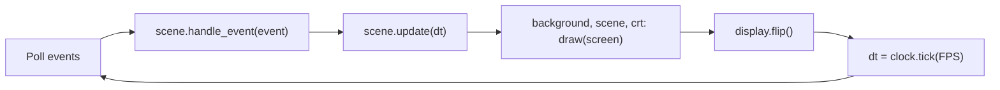

# 🏗️ Architecture

## Modules

All the code lives in the `tlamina` package, grouped by the role each module plays rather than by feature: in a game, every feature meets every other one in the same loop and the same collision checks, so slicing by feature would split code that changes together.

| Module | Role |
|---|---|
| `__main__.py` | Creates the window and runs the [game loop](patterns/game-loop.md); `python -m tlamina` starts here |
| `scenes.py` | Splash, playing, pause, and game over screens, each deciding which one comes next ([State](patterns/state.md)) |
| `game.py` | Owns a run: sprite groups, score, combo, lives, waves, timers, collisions, and fleet movement |
| `highscore.py` | Loads and saves the high score in the user's data folder |
| `resources.py` | Resolves asset paths, cuts sprites out of the atlas by name, and caches images, sounds, and fonts ([Flyweight](patterns/flyweight.md)) |
| `settings.py` | Gameplay tuning values. Speeds are in pixels per second and times in seconds |
| `entities/` | Sprites that move and collide: `player`, `enemy` (the fleet and the bonus ufo), `laser` (lasers and the arrow), `obstacle`, `powerup`. Each one moves itself in `update(dt)` ([Update Method](patterns/update-method.md)) |
| `visuals/` | Things that are only drawn and never affect the game: `background`, `effects` (explosions, floating text, screen shake), the `crt` overlay, and `ui` text |

Dependencies point one way: `__main__` → `scenes` → `game` → `entities` / `visuals` → `resources` / `settings`. Entities never import `game`, so each one can be created and tested on its own.

## One frame

While playing, `scene.update(dt)` calls `game.update(dt)`, which runs in a fixed order:

1. Player input, movement, shooting cooldown, arrow charge, and power-up timers; the player's lasers move
2. Timers: bonus ufo spawn and fleet shots
3. Collisions: player lasers against meteors, enemies, and the ufo; power-up pickups; enemy lasers against the player and meteors; the fleet against meteors and the player
4. A new wave if the fleet was cleared
5. Fleet movement and edge bounces; enemy lasers, the ufo, power-ups, and effects move
6. The combo checks which shots left the screen without hitting anything

Logic and drawing are separate, so tests can call `update(dt)` with a fixed `dt` and check the state without opening a window.

## Drawing

`Game.draw` draws the world (sprites and effects) onto a transparent layer of its own and blits it with the screen shake offset, then draws the HUD straight onto the screen. That way the world can shake while the score, lives, and power-up timers stay still and readable.

## State

Which screen is showing is decided by the scenes ([State](patterns/state.md)). Inside a run, `Game.state` is either `playing` or `game_over`; `PlayingScene` checks it every frame and hands over to `GameOverScene` when the run ends.
