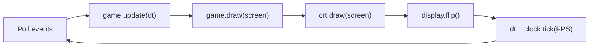

# 🏗️ Architecture

## Modules

| Module | Role |
|---|---|
| `main.py` | Creates the window and runs the [game loop](patterns/game-loop.md) |
| `game.py` | Owns the game state: sprite groups, score, lives, timers, collisions, and fleet movement |
| `player.py`, `enemy.py`, `laser.py`, `obstacle.py` | Sprites. Each one moves itself in `update(dt)` ([Update Method](patterns/update-method.md)) |
| `crt.py` | Post-processing overlay drawn on top of each frame |
| `resources.py` | Resolves asset paths, cuts sprites out of the atlas by name, and caches images and sounds ([Flyweight](patterns/flyweight.md)) |
| `settings.py` | Gameplay tuning values. Speeds are in pixels per second and times in seconds |

Dependencies point one way: `main` → `game` → sprites → `resources` / `settings`. Sprites never import `game`, so each one can be created and tested on its own.

## One frame

`game.update(dt)` runs in a fixed order:

1. Player input, movement, and shooting cooldown
2. Timers: bonus alien spawn and UFO shots
3. Collisions: lasers against UFOs, the alien, obstacles, and the player
4. UFO fleet movement and edge bounces
5. Laser and alien movement, removing anything that left the screen

Logic and drawing are separate, so tests can call `update(dt)` with a fixed `dt` and check the state without opening a window.

## State

`Game.state` is either `playing` or `game_over`. `main.py` closes the game on `game_over` for now; phase 5 replaces this with scenes (State pattern).
