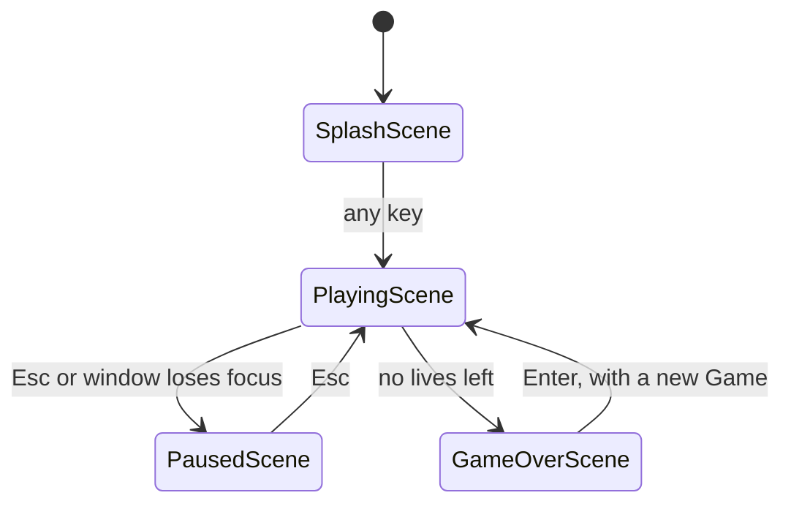

# 🏗️ Architecture

How Tlamina is built, and why. What the game is trying to be is in the [game design document](game-design.md).

Four patterns from Robert Nystrom's [*Game Programming Patterns*](https://gameprogrammingpatterns.com) shape the code. This page explains how each one is used here; the book links are there for the full background.

## Modules

All the code lives in the `tlamina` package, grouped by the role each module plays rather than by feature: in a game, every feature meets every other one in the same loop and the same collision checks, so slicing by feature would split code that changes together.

| Module | Role |
|---|---|
| `__main__.py` | Creates the window and runs the game loop; `python -m tlamina` starts here |
| `scenes.py` | Splash, playing, pause, and game over screens, each deciding which one comes next |
| `game.py` | Owns a run: sprite groups, score, combo, lives, waves, timers, collisions, and fleet movement |
| `highscore.py` | Loads and saves the high score in the user's data folder |
| `resources.py` | Resolves asset paths, cuts sprites out of the atlas by name, and caches images, sounds, and fonts |
| `settings.py` | Gameplay tuning values. Speeds are in pixels per second and times in seconds |
| `entities/` | Sprites that move and collide: `player`, `enemy` (the fleet and the bonus ufo), `laser` (lasers and the arrow), `obstacle`, `powerup` |
| `visuals/` | Things that are only drawn and never affect the game: `background`, `effects` (explosions, floating text, screen shake), the `crt` overlay, and `ui` text |

Dependencies point one way: `__main__` → `scenes` → `game` → `entities` / `visuals` → `resources` / `settings`. Entities never import `game`, so each one can be created and tested on its own.

## One frame

While playing, `game.update(dt)` runs in a fixed order:

1. Player input, movement, shooting cooldown, arrow charge, and power-up timers; the player's lasers move
2. Timers: bonus ufo spawn and fleet shots
3. Collisions: player lasers against meteors, enemies, and the ufo; power-up pickups; enemy lasers against the player and meteors; the fleet against meteors and the player
4. A new wave if the fleet was cleared
5. Fleet movement and edge bounces; enemy lasers, the ufo, power-ups, and effects move
6. The combo checks which shots left the screen without hitting anything

Then everything is drawn. `Game.draw` puts the world (sprites and effects) on a transparent layer of its own and blits it with the screen shake offset, then draws the HUD straight onto the screen, so the world can shake while the score, lives, and power-up timers stay still.

Each frame is drawn completely onto the display surface and only shown when `pygame.display.flip()` swaps it in, so the player never sees a half-drawn frame. That's the book's [Double Buffer](https://gameprogrammingpatterns.com/double-buffer.html), which pygame provides for free. Redrawing the whole 800×800 screen every frame keeps the drawing code simple and takes about 6 ms on a busy frame, well within the 16.7 ms of a 60 FPS frame.

## Patterns in this game

### 🔁 Game Loop

[Book chapter](https://gameprogrammingpatterns.com/game-loop.html) · `tlamina/__main__.py`

The game has to keep running whether or not the player presses anything, and at the same speed on a fast desktop and a slow laptop. The loop handles input without blocking, updates, and draws, and passes the time since the previous frame, `dt`, to everything that moves:

```python
while running:
    for event in pygame.event.get():
        scene = scene.handle_event(event)
    background.update(dt)
    scene = scene.update(dt)
    background.draw(screen)
    scene.draw(screen)
    crt.draw(screen)
    pygame.display.flip()
    dt = min(clock.tick(FPS) / 1000, MAX_DT)
```

- Every speed in `settings.py` is in pixels per second and every timer counts `dt`, so the game plays the same at 30, 60, or 144 FPS. `test_fleet_movement_does_not_depend_on_frame_rate` checks it.
- `clock.tick(FPS)` caps the loop at 60 FPS, and `MAX_DT` (0.05 s) clamps long frames, like while the window is dragged, so nothing jumps through anything else.
- Anything that skips `dt` brings frame-rate dependence back. Fleet bounces did: the distance past the edge grew with the frame time, so `Game.enemy_bounce` reflects it back.
- A variable time step makes the simulation slightly non-deterministic. That's fine for a single-player arcade game, and tests stay deterministic by passing a fixed `dt`.

### 🧩 Update Method

[Book chapter](https://gameprogrammingpatterns.com/update-method.html) · `update(dt)` on every sprite, `Effects`, and `Game`

The world holds many independent objects: the player, 24 enemies, the ufo, power-ups, lasers, and explosion particles. Each one moves itself in `update(dt)`, and pygame's `Group.update()` calls it on every member, so `Game` doesn't need to know how any of them move. The player reads input and counts down its timers, enemies move and fade their hit flash, lasers fly straight or at an angle, and each of them removes itself when it leaves the screen.

- `Game.update(dt)` is the update method of the whole run. It handles what involves more than one object: collisions, the combo, and the fleet, which has to reverse as a unit when any enemy touches an edge.
- Update order matters. Player lasers move before collisions are checked, while enemies, enemy lasers, and the ufo move after, so their hits are detected one frame later. The order is the same every frame, so the delay is consistent.
- One level up, a scene decides whether the game advances at all: the pause screen simply doesn't call `game.update`.

### 🪶 Flyweight

[Book chapter](https://gameprogrammingpatterns.com/flyweight.html) · `tlamina/resources.py`

Every enemy, laser, and meteor needs an image, and many of them share the same one. Before this pattern, each new laser read its PNG from disk, several times a second. Now `resources.py` caches every asset with `functools.cache`, so all enemies of the same color and model, and every laser ever fired, share one surface; each sprite only keeps its own position, speed, and health.

- All sprites come from one image, `assets/atlas.png`, built by [`tools/build_atlas.py`](../tools/README.md). The game reads it once and cuts and scales each sprite the first time it's needed, so changing `SPRITE_SCALE` resizes everything without touching the art.
- Shared surfaces must never be drawn on, or the change would show up on every sprite using them. The CRT effect draws on a surface of its own, and the player's damage cracks are drawn on a copy of the ship.

### 🚦 State

[Book chapter](https://gameprogrammingpatterns.com/state.html) · `tlamina/scenes.py`

The splash, the game, the pause screen, and game over each react to different keys and draw different things. Instead of checking a mode flag everywhere, each screen is a class with the same three methods, and `handle_event` and `update` return the scene to show next, usually `self`. The loop only ever talks to the current scene.



- `PausedScene` keeps the `PlayingScene` it paused and draws it dimmed underneath, then returns that same object to resume, so nothing is lost. It's the book's pushdown automaton in its smallest form: one reference instead of a stack, which is enough with a single overlay screen.
- Transitions are plain return values, so tests drive them by calling `handle_event` with a fake event.
- `Game.state` (`playing` or `game_over`) still exists: it's how a run tells `PlayingScene` it ended, without `game.py` importing the scenes.

## Considered and left out

| Pattern | Why not |
|---|---|
| [Type Object](https://gameprogrammingpatterns.com/type-object.html) | Planned for waves and enemy types defined as data. Every wave ended up being the same formation with scaled numbers and the next enemy model, which a short formula in `Game.start_next_wave` expresses better than a data format. It would pay off with handmade waves or enemies that behave differently. |
| [Observer](https://gameprogrammingpatterns.com/observer.html) | Considered for decoupling sounds and effects from collisions. Each collision has exactly one reaction, written where it happens in `Game.collision_checks`, so an event system would add indirection without a second listener to justify it. |
| [Object Pool](https://gameprogrammingpatterns.com/object-pool.html) | Fewer than 30 lasers and a few hundred particles are alive at once, so allocating them is not a measurable cost. |
| [Component](https://gameprogrammingpatterns.com/component.html) / ECS | Every entity has a small, fixed set of behaviors. Plain sprite classes are easier to read at this size (~1,300 lines). |
| [Spatial Partition](https://gameprogrammingpatterns.com/spatial-partition.html) | A few dozen sprites collide per frame; checking them all takes about 0.1 ms. |
