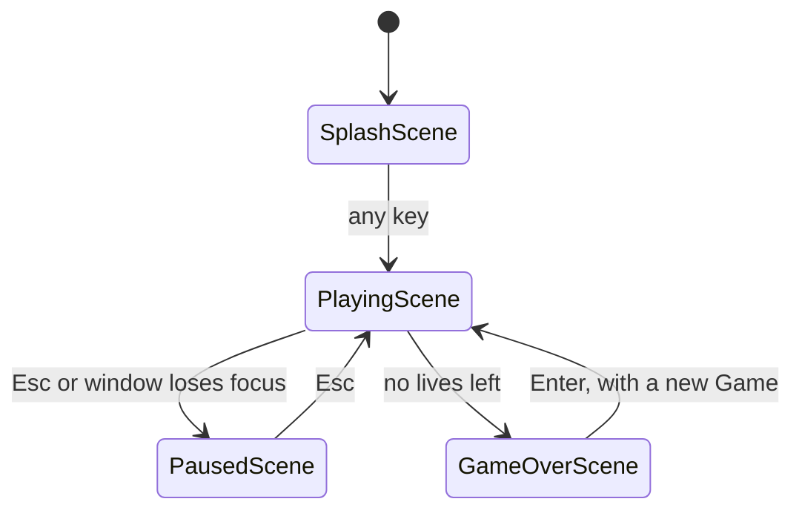

# 🚦 State

## Problem

The game shows four different screens: the splash, the game itself, the pause screen, and game over. Each one reacts to different keys and draws different things. Keeping them all in one loop means checking a mode flag in every branch: "if paused, ignore Space; if on the splash, any key starts; if game over, Enter restarts...". Every new screen would touch all of those checks, and before this pattern, losing simply closed the window.

## Pattern

> Allow an object to alter its behavior when its internal state changes. The object will appear to change its class.

— [*Game Programming Patterns*, "State"](https://gameprogrammingpatterns.com/state.html), quoting the Gang of Four

The book's version: each state is a class with the same methods, the owner delegates to whichever state is current, and a state decides by itself which state comes next.

## In Tlamina

`tlamina/scenes.py` has one class per screen, all sharing the same three methods. `handle_event` and `update` return the scene to show next, usually `self`:

```python
scene = scene.handle_event(event)
scene = scene.update(dt)
scene.draw(screen)
```

The game loop in `__main__.py` doesn't know which scenes exist, only that the current one may hand over to another.



| Scene | Holds | Notes |
|---|---|---|
| `SplashScene` | A `Game` used only as a moving backdrop | Also handles the clickable [licaza.dev](https://licaza.dev) link |
| `PlayingScene` | The current `Game` | The only scene that advances the game |
| `PausedScene` | The `PlayingScene` it paused | Resuming returns that same object, so nothing is lost |
| `GameOverScene` | The finished `Game` | Saves the high score once, when it's created |

Pausing is the book's **pushdown automaton** idea in its smallest form: `PausedScene` keeps a reference to the scene underneath and draws it dimmed, instead of a stack of states.

## Trade-offs

- ✅ Each screen's input, update, and drawing live together, and adding a screen means adding a class, not editing the others.
- ✅ Transitions are plain return values, so tests drive them by calling `handle_event` with a fake event (`tests/test_scenes.py`).
- ⚠️ Scenes are created fresh on every transition, so anything that must survive one, like the paused game, has to be passed in explicitly.
- ⚠️ `Game.state` still exists, with `playing` and `game_over`: it's how `Game` tells `PlayingScene` the run ended, without importing the scenes.
- ❌ Not used: a full **state stack**. With one overlay screen (pause), a single reference is enough; a stack would pay off with nested menus.
